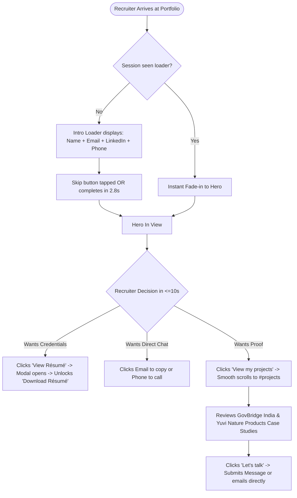
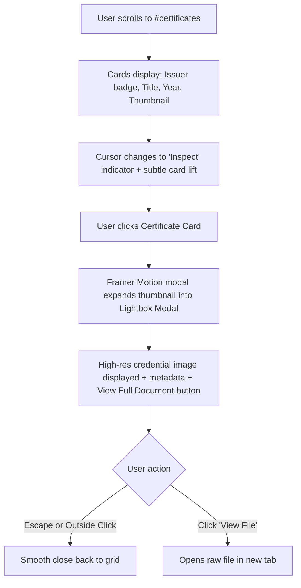

# UI/UX Specification — Dheeren's Portfolio (v2 Rebuild)

## 1. Information Architecture & Sitemap

```
Single-Page Application Root (/)
 ├─ [Intro Loader] ── (Session-gated 3.0s editorial intro overlay with skip)
 │
 ├─ Header / Navigation (Fixed, backdrop-filter, scroll-direction sensitive, progress indicator)
 │   ├─ Wordmark Logo ("Dheeren ·")
 │   ├─ Links: #about, #skills, #projects (Projects), #education, #certificates, #contact
 │   └─ Action: "Resume" (Pill CTA with magnetic hover)
 │
 ├─ Main Content
 │   ├─ Section 01: #hero
 │   │   ├─ Status Eyebrow: "DATA SCIENCE · BANGALORE"
 │   │   ├─ Availability Pill: Soft green pulse indicator ("Open to internships")
 │   │   ├─ Display Name: "Dheeren"
 │   │   ├─ Value Statement: "Data Science undergraduate who analyzes data and builds real-world web projects."
 │   │   ├─ Primary Actions: [View my projects] + [View Résumé / Download Résumé]
 │   │   ├─ Quick Connect Icons: [Email (copy)], [LinkedIn (dheerengowda)], [Phone]
 │   │   └─ Hero Media: Portrait masked in editorial rounded container with parallax
 │   │
 │   ├─ Section 02: #about
 │   │   ├─ Eyebrow: "01 — ABOUT"
 │   │   ├─ Big Pull Statement: Academic & analytical background
 │   │   ├─ Full Narrative: Practical skills, Deloitte simulation, full-stack journey
 │   │   └─ At-A-Glance Stat Grid: Degree, CGPA (animated 8.09), Graduation Year (2028), Location
 │   │
 │   ├─ Section 03: #skills
 │   │   ├─ Eyebrow: "02 — SKILLS"
 │   │   ├─ Infinite Skills Marquee (Core tools & technologies ticker)
 │   │   └─ 4 Grouped Cards: Programming, Data, Web Development, Tools & Concepts
 │   │
 │   ├─ Section 04: #projects
 │   │   ├─ Eyebrow: "03 — SELECTED WORKS"
 │   │   ├─ Alternating 2-Row Featured Case Studies:
 │   │   │   ├─ Case Study 1: GovBridge India — AI-Powered Government Scheme Platform · Team Project
 │   │   │   │   ├─ Status: Live pill + Team project badge
 │   │   │   │   ├─ Actions: [Visit live site] (gov-bridge-india.vercel.app) + [View on GitHub]
 │   │   │   │   ├─ 4 Core Bullets: Scheme matching, Age/income/state filters, GovBot LangChain bot, Multilingual support
 │   │   │   │   └─ Browser-Frame Mockup Panel: URL bar, window controls, hover tilt
 │   │   │   └─ Case Study 2: Yuvi Nature Products — Business Website · 2026
 │   │   │       ├─ Status: Live indicator pill
 │   │   │       ├─ Action: [Visit live site] (yuvinature-products.netlify.app)
 │   │   │       ├─ 4 Core Bullets: Concept-to-live, Product catalog, WhatsApp integration, Netlify hosting
 │   │   │       └─ Browser-Frame Mockup Panel: URL bar, window controls, hover tilt
 │   │   └─ Quiet Indicator: "More projects coming soon"
 │   │
 │   ├─ Section 05: #education
 │   │   ├─ Eyebrow: "04 — ACADEMICS"
 │   │   └─ Vertical Timeline with Drawing Hairline:
 │   │       ├─ Milestone 1: B.Tech in Data Science (NCET, 2024–2028, CGPA 8.09 / 10)
 │   │       ├─ Milestone 2: Pre-University 12th (Ambika PU College, 2022–2024, PCMC 93%)
 │   │       └─ Milestone 3: SSLC 10th (Kumaraswamy High School, 2021–2022, 95.36%)
 │   │
 │   ├─ Section 06: #certificates
 │   │   ├─ Eyebrow: "05 — CREDENTIALS"
 │   │   ├─ Dynamic Certificate Cards: Deloitte Simulation, Cisco Networking
 │   │   └─ Accessible Lightbox / Modal: Full inspection view + direct PDF link
 │   │
 │   └─ Section 07: #contact
 │       ├─ Eyebrow: "06 — INITIATE CONTACT"
 │       ├─ Headline: "Let's talk."
 │       ├─ Left Column: Direct channels (Email, Phone, LinkedIn, Résumé) with slide-fill hover
 │       └─ Right Column: Contact form (Name, Email, Message, Honeypot) + Validation
 │
 └─ Footer
     ├─ Bengaluru Local Clock (Live IST clock updating every second)
     ├─ Back to Top Magnetic Button
     ├─ Copyright Statement: © 2026 Dheeren
     └─ Colophon: "Designed & engineered with Next.js & Tailwind CSS"
```

---

## 2. Key User Flows

### Flow A: Recruiter 10-Second High-Conversion Scan


### Flow B: Certificate Deep-Dive & Inspection Flow


---

## 3. Wireframes

### Desktop View (1280px+)

```
+---------------------------------------------------------------------------------------+
| [Dheeren ·]                   About  Skills  Projects  Education  Certs  [Resume CTA] |
+---------------------------------------------------------------------------------------+
|                                                                                       |
|   BANGALORE · DATA SCIENCE (● Open to internships)      +-------------------------+   |
|                                                         |                         |   |
|   Dheeren                                               |   [Studio Portrait]     |   |
|                                                         |   Warm Cream Backdrop   |   |
|   Data Science undergraduate who analyzes data and      |   Editorial Soft Mask   |   |
|   builds real-world web projects.                       |                         |   |
|                                                         |                         |   |
|   [ View my projects -> ]   [ View Résumé ]             +-------------------------+   |
|                                                                                       |
|   ✉ dheeren438@gmail.com   in LinkedIn   ☎ +91 76249 56501                            |
|                                                                                       |
|   V scroll down                                                                       |
+---------------------------------------------------------------------------------------+
| 01 — ABOUT                                                                            |
|                                                                                       |
| "Data Science undergraduate with hands-on experience    [ Degree ]      [ CGPA ]      |
| in Python, SQL, and analytical modeling through         B.Tech DS       8.09 / 10     |
| applied enterprise simulations."                        (NCET)          (Count-up)    |
|                                                                                       |
| Summary text describing Deloitte simulation, web        [ Grad Year ]   [ Location ]  |
| initiative, and proactive technical problem solving.   Expected 2028   Bengaluru     |
+---------------------------------------------------------------------------------------+
| 02 — SKILLS                                                                           |
| <<< MARQUEE: PYTHON · SQL · DATA ANALYSIS · STATISTICS · NODE.JS · GIT >>>            |
|                                                                                       |
| +---------------------+ +---------------------+ +---------------------+ +-----------+ |
| | Programming         | | Data Analytics      | | Web Development     | | Tools     | |
| | [Python] [Java]     | | [Data Cleaning]     | | [HTML] [CSS]        | | [Git]     | |
| | [C] [SQL]           | | [Statistics]        | | [JavaScript]        | | [Forensic]| |
| |                     | | [Database Fund.]    | | [Node.js] [Express] | | [Database]| |
| +---------------------+ +---------------------+ +---------------------+ +-----------+ |
+---------------------------------------------------------------------------------------+
| 03 — SELECTED WORKS (Featured Projects)                                               |
|                                                                                       |
| [Project 1: GovBridge India — AI Platform · Team Project]                             |
| 2026 / AI Platform · Team Project / ● Live / [Team Project Badge]                     |
| GOVBRIDGE INDIA — AI-POWERED GOVERNMENT SCHEME PLATFORM                               |
| Citizen scheme matching platform with multilingual AI assistant                       |
| - Team-built platform matching citizens to eligible govt schemes                      |
| - Age, occupation, income, and state-based scheme recommendations                     |
| - GovBot AI chatbot (LangChain + Gemini/OpenAI) for eligibility                       |
| - Multilingual: Kannada, Hindi, Telugu, Tamil, Malayalam, English                     |
| [Tags: Next.js, React, Tailwind, Framer, Node, Express, Firebase, LangChain]          |
| [ Visit live site -> ]  [ View on GitHub ]                                            |
|                                                                                       |
| [Project 2: Yuvi Nature Products — Commercial Website]                                |
| 2026 / Commercial Website / ● Live                                                    |
| YUVI NATURE PRODUCTS — BUSINESS WEBSITE                                               |
| Responsive business site for arecanut leaf plate manufacturer                         |
| - Concept to live publicly accessible site                                            |
| - Product catalog for all device form factors                                         |
| - WhatsApp-integrated customer enquiry form                                           |
| - Deployed live on Netlify                                                            |
| [Tags: Responsive Design, Product Catalog, WhatsApp Integration, Netlify]             |
| [ Visit live site -> ]                                                                |
|                                                                                       |
| -------------------------- More projects coming soon -------------------------------- |
+---------------------------------------------------------------------------------------+
| 04 — ACADEMICS (Vertical Timeline)                                                    |
|                                                                                       |
| |  2024 — 2028   B.Tech in Data Science · NCET Bangalore                              |
| ●  (Active Yr 3) CGPA: 8.09 / 10 · Expected 2028                                      |
| |                                                                                     |
| |  2022 — 2024   Pre-University (12th) · Ambika PU College, Puttur                    |
| ●  (Completed)   Course: PCMC · Percentage: 93%                                       |
| |                                                                                     |
| |  2021 — 2022   SSLC (10th) · Kumaraswamy English Medium School, Subrahmanya         |
| ●  (April 2022)  KSEEB · Percentage: 95.36% (596 / 625)                               |
+---------------------------------------------------------------------------------------+
| 05 — CREDENTIALS                                                                      |
| +------------------------------------+  +------------------------------------+        |
| | [Deloitte Certificate Image]       |  | [Cisco Certificate Image]          |        |
| | Data Analytics Job Simulation      |  | Cisco Networking Essentials        |        |
| | Deloitte (Forage) · 2026           |  | Cisco Networking Academy · 2026    |        |
| +------------------------------------+  +------------------------------------+        |
+---------------------------------------------------------------------------------------+
| 06 — INITIATE CONTACT                                                                 |
| Let's talk.                                                                           |
|                                                                                       |
| [->] Email: dheeren438@gmail.com        [ Name                         ]              |
| [->] Phone: +91 76249 56501             [ Email Address                ]              |
| [->] LinkedIn: dheerengowda             [ Message Body                 ]              |
| [->] Résumé (PDF Download)              [ Send Message Button ->       ]              |
+---------------------------------------------------------------------------------------+
| Bengaluru, [Time] IST          Designed & Engineered by Dheeren          [ Back to top ]
+---------------------------------------------------------------------------------------+
```
